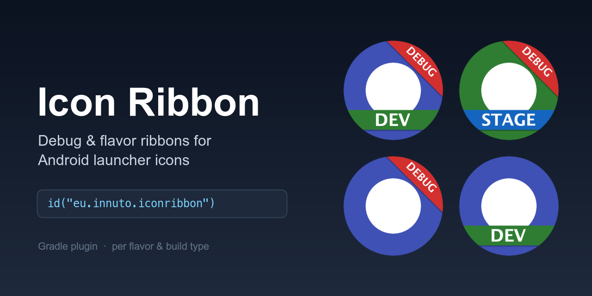
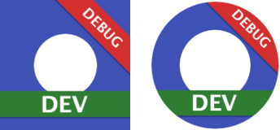
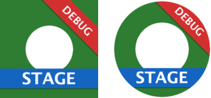
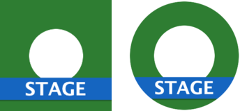
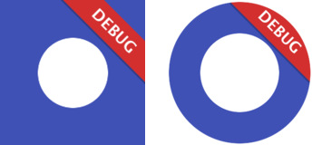

# icon-ribbon

[](https://github.com/innuto/icon-ribbon-gradle-plugin/actions/workflows/ci.yml)
[](https://plugins.gradle.org/plugin/eu.innuto.iconribbon)
[](https://ko-fi.com/ttkalcevic)



Gradle plugin that draws a ribbon (like Flutter's `DEBUG` banner) over Android launcher icons,
configured per product flavor and build type. Source icons are never modified: decorated copies go
into a generated res folder that AGP merges on top.

## Installation

The plugin is published on the [Gradle Plugin Portal](https://plugins.gradle.org/plugin/eu.innuto.iconribbon).
Add it to the app module, nothing else is needed, since new Android projects already list
`gradlePluginPortal()` under `pluginManagement.repositories`:

```kotlin
// app/build.gradle.kts
plugins {
    id("com.android.application")
    id("eu.innuto.iconribbon") version "0.1.0"
}
```

Or via the version catalog:

```toml
[plugins]
icon-ribbon = { id = "eu.innuto.iconribbon", version = "0.1.0" }
```

## Usage

Configure the ribbon inside each product flavor and/or build type:

```kotlin
// app/build.gradle.kts
import eu.innuto.iconribbon.RibbonPosition
import eu.innuto.iconribbon.iconRibbon

plugins {
    id("com.android.application")
    id("eu.innuto.iconribbon") version "0.1.0"
}

android {
    buildTypes {
        debug {
            iconRibbon { }                    // "DEBUG", red, top-right
        }
    }
    productFlavors {
        create("staging") {
            iconRibbon {
                text = "STAGING"              // default: flavor name upper-cased
                backgroundColor = "#1565C0"
                position = RibbonPosition.BOTTOM
            }
        }
        create("prod") {
            iconRibbon { enabled = false }    // no ribbon, not even DEBUG in prodDebug
        }
    }
}
```

Groovy works the same (`iconRibbon { text = "STAGING" }`), no import needed.

**Stacking:** a variant gets every ribbon of its flavors and its build type: `stagingDebug` above
shows both STAGING and DEBUG, `stagingRelease` only STAGING. Ribbons of one variant must use
different positions, otherwise the build fails naming both. An explicit `enabled = false` anywhere
in the chain (like `prod` above) keeps that variant's icon clean. Variants with no ribbon at all are
left completely untouched.

| Option            | Default              |
|-------------------|----------------------|
| `text`            | flavor / build type name, upper-cased |
| `backgroundColor` | `#D32F2F` (`#RRGGBB` / `#AARRGGBB`) |
| `textColor`       | `#FFFFFF`            |
| `position`        | `TOP_RIGHT` (`TOP_LEFT`, `TOP_RIGHT`, `BOTTOM_LEFT`, `BOTTOM_RIGHT`, `TOP`, `BOTTOM`) |
| `enabled`         | `true` once `iconRibbon { }` is used |
| `iconNames`       | module-wide list (see below) |

### Which icons are decorated

By default `ic_launcher` and `ic_launcher_round`. Change it for the whole module with a top-level
block:

```kotlin
iconRibbon {
    iconNames = listOf("ic_launcher", "ic_launcher_round", "ic_launcher_alt")
}
```

A flavor or build type can replace that list for its variants, e.g. when it ships its own icon:

```kotlin
productFlavors {
    create("dev") {
        iconRibbon { iconNames = listOf("ic_launcher_dev") }
    }
}
```

If several flavors / the build type of one variant set `iconNames`, their names are combined. Names
are plain resource names: `ic_launcher`, not `ic_launcher.png` or `@mipmap/ic_launcher`.

## Examples

Output of the [`sample`](sample/build.gradle.kts) app, configured with:

```kotlin
buildTypes {
    debug { iconRibbon { } }
}
productFlavors {
    create("dev") {
        iconRibbon { backgroundColor = "#2E7D32"; position = RibbonPosition.BOTTOM }
    }
    create("staging") {
        iconRibbon { text = "STAGE"; backgroundColor = "#1565C0"; position = RibbonPosition.BOTTOM }
    }
    create("prod")
}
```

Each cell shows the legacy PNG icon (left) and the adaptive icon (right). The adaptive icon is
pictured under a circular launcher mask; other launchers use other mask shapes.

| | debug | release |
|---|---|---|
| **dev** |  |  |
| **staging** |  |  |
| **prod** |  |  <br> untouched |

The sample's `staging` flavor has its own green icon: a legacy PNG in
`src/staging/res/mipmap-xxxhdpi/` and the adaptive background color in `src/staging/res/values/`.
The ribbons are drawn on that icon, not on the one from `main`.

## How it works

For each matching variant a `generate<Variant>IconRibbon` task runs before resource merging. Drawing
happens in a separate headless Gradle worker process, so the Gradle daemon's JVM is left untouched.

What it does depends on the icon type:

- **Raster icons** (`png`, `webp`, `jpg` in `mipmap-*` / `drawable-*`) — the ribbon is painted into
  the bitmap and written as PNG. It is clipped to the icon's own alpha, so round icons stay round.
- **Adaptive icons** (`<adaptive-icon>` XML) — the foreground is replaced by a `<layer-list>` of the
  original foreground plus a transparent ribbon overlay. Background and `monochrome` are kept, so
  themed (Material You) icons show no ribbon.

Ribbon geometry assumes the visible icon shape is inscribed in the icon square (the adaptive-icon
72dp viewport), so the text stays visible under circular launcher masks.

Overrides in flavor/build-type res folders (e.g. `src/staging/res/mipmap-*/ic_launcher.webp`) are
respected, the plugin decorates whichever file AGP would have picked.

## Requirements

- AGP 8.4+ (`com.android.application`)
- Gradle 8.6+ (required by AGP 8.4)
- JDK 17
- Configuration-cache compatible

## Limitations

- Non-adaptive vector-drawable launcher icons are skipped with a warning.
- Fonts come from the build machine's JVM (`SansSerif` bold), so glyphs can differ slightly between
  machines/CI.

## Development

```bash
./gradlew -p plugin test validatePlugins     # unit tests + plugin validation
./gradlew :sample:assembleStagingDebug       # end-to-end; output in sample/build/generated/res
./gradlew -p plugin publishToMavenLocal      # try it in another project via mavenLocal()
```

### Releasing

1. In [`CHANGELOG.md`](CHANGELOG.md), rename `## [Unreleased]` to `## [0.2.0] - <date>`, add a
   fresh empty `## [Unreleased]` above it and update the compare links at the bottom.
2. Bump `version` in `plugin/gradle.properties`.
3. Push a matching tag: `git tag v0.2.0 && git push origin v0.2.0`.
4. The [Release workflow](.github/workflows/release.yml) checks the changelog has a `0.2.0`
   section, tests, runs `publishPlugins`, creates the GitHub Release from that section and updates
   the versions in this README.

It needs the `GRADLE_PUBLISH_KEY` and `GRADLE_PUBLISH_SECRET` repository secrets (API key from your
[Plugin Portal account](https://plugins.gradle.org/user/login)).

## License

[MIT](LICENSE)
